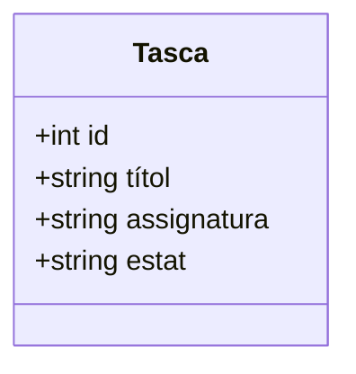

# SPECIFICATIONS.md — Sistema Tasks_app (v1.0)

## 1. Visió General
Tasks_app és una eina CLI lleugera per ajudar als estudiants a gestionar les seves tasques acadèmiques diàries.

## 2. User Stories (Històries d'Usuari)
- US-01: Com a estudiant, vull afegir una tasca amb títol i assignatura per recordar els meus deures.
- US-02: Com a estudiant, vull veure la llista de tasques pendents per organitzar el meu temps.

## 3. Model de Dades (Mermaid)

## 4. Requisits
- RF-01 : El sistema tasks_app ha de guardar les tasques en un fitxer JSON de persistència local.
- RF-02 : Si el fitxer `data/tasks.json` no existeix, el sistema tasks_app ha de crear `data/tasks.json`  inicialitzat amb una llista JSON buida ([])
- RF-03 : El sistema tasks_app ha de proveir a l'estudiant la capacitat de crear una nova tasca amb estat 'pendent' mitjançant el comandament add --title <títol> --subject <assignatura>.
- RF-04: El sistema tasks_app ha de proveir a l’estudiant la capacitat de visualitzar totes les tasques registrades (incloent-hi el seu ID, títol, assignatura i estat) mitjançant el comandament list.

## 5. Criteris d’acceptació i proves (Gherkin scenarios)
- GS-01: Creació correcta d'una tasca
  Atès que la base de dades JSON no conté encara tasques
  quan l’estudiant executa `python src/tasks_app.py add --title 'Pràctica 1' --subject 'RS'
  aleshores el sistema confirma `Tasca [ID: 1] creada amb èxit`
  i la tasca queda registrada al fitxer `data/tasks.json`.

- GS-02: Llistat de tasques quan `data/tasks.json` no conté registres 
  Atès que la base de dades JSON no conté encara tasques
  quan l’estudiant executa `python src/tasks_app.py list`
  aleshores el sistema mostra `Registre de tasques buit.` 

- GS-03: Llistat de tasques quan data/tasks.json conté registres
  Atès que el fitxer `data/tasks.json` conté les següents tasques:
    | id | títol          | assignatura | estat   |
    | 1  | Pràctica 1     | RS          | pendent |
    | 2  | Examen parcial | SO          | pendent |
  quan l’estudiant executa `python src/tasks_app.py list`
  aleshores el sistema mostra per pantalla:
    "[1] Pràctica 1 (RS) - estat: pendent"
    "[2] Examen parcial (SO) - estat: pendent"

## 6. Iteració 2 (v2.0)
Funcionalitats incorporades: data límit, modificació de tasques, completar tasques i etiquetes [CADUCADA] / [URGENT] al llistat.
 
### 6.1 User Stories
- US-03: Com a estudiant, vull indicar una data límit en crear una tasca per tal de saber quan l'he d'haver lliurat.
- US-04: Com a estudiant, vull modificar qualsevol atribut d'una tasca a partir del seu ID per tal de corregir errors comesos en registrar-la.
- US-05: Com a estudiant, vull marcar una tasca com a completada per tal de distingir la feina feta de la pendent.
- US-06: Com a estudiant, vull que el llistat m'avisi de les tasques caducades i urgents per tal de prioritzar la feina.

### 6.2 Requisits 
**Data límit**
- RF-05: El sistema tasks_app ha de proveir a l'estudiant la capacitat d'indicar una data límit amb el format YYYY-MM-DD mitjançant l'opció --due <data> en el comandament add.

- RF-06: Si la data indicada a --due no segueix el format YYYY-MM-DD o no és una data vàlida, el sistema tasks_app ha de mostrar el missatge `Error: la data límit ha de tenir el format YYYY-MM-DD` i no ha de modificar `data/tasks.json`.

- RF-07: Si l'estudiant no indica l'opció --due, el sistema tasks_app ha de crear la tasca sense data límit.

**Modificació de tasques**
- RF-08: El sistema tasks_app ha de proveir a l'estudiant la capacitat de modificar el títol, l'assignatura, la data límit i l'estat d'una tasca existent mitjançant el comandament edit --id <ID> seguit d'una o més de les opcions --title <títol>, --subject <assignatura>, --due <data> i --status <estat>.

- RF-09: Quan una modificació es completi correctament, el sistema tasks_app ha de mostrar el missatge `Tasca [ID: <ID>] modificada amb èxit`.

- RF-10: Si no existeix cap tasca amb l'ID indicat, el sistema tasks_app ha de mostrar el missatge `Error: no existeix cap tasca amb ID <ID>` i no ha de modificar `data/tasks.json`.

- RF-11: Si l'estudiant executa el comandament edit sense cap opció de modificació, el sistema tasks_app ha de mostrar el missatge `Error: cal indicar almenys un camp a modificar`.

- RF-12: Si el valor de --status és diferent de 'pendent' o 'completada', el sistema tasks_app ha de mostrar el missatge `Error: l'estat ha de ser 'pendent' o 'completada'` i no ha de modificar `data/tasks.json`.

**Completar tasques**
- RF-13: El sistema tasks_app ha de proveir a l'estudiant la capacitat de canviar l'estat d'una tasca a 'completada' mitjançant el comandament complete --id <ID>, i ha de mostrar el missatge `Tasca [ID: <ID>] marcada com a completada`.

- RF-14: Si no existeix cap tasca amb l'ID indicat al comandament complete, el sistema tasks_app ha de mostrar el missatge `Error: no existeix cap tasca amb ID <ID>`.

**Llistat amb avisos**
- RF-15: Si una tasca té data límit, el sistema tasks_app ha de mostrar-la al comandament list amb el format `- límit: YYYY-MM-DD` darrere de l'estat. Les tasques sense data límit s'han de mostrar amb el format de la v1.0.

- RF-16: Si una tasca té estat 'pendent' i la seva data límit és anterior a la data actual, el sistema tasks_app ha de mostrar l'etiqueta `[CADUCADA]` al final de la línia de la tasca.

- RF-17: Si una tasca té estat 'pendent' i falten menys de 7 dies per a la seva data límit (de 0 a 6 dies, ambdós inclosos), el sistema tasks_app ha de mostrar l'etiqueta `[URGENT]` al final de la línia de la tasca.

- RF-18: El sistema tasks_app no ha de mostrar cap etiqueta en les tasques amb estat 'completada'.

### 6.3 Criteris d'acceptació (Gherkin scenarios)
 
- GS-04: Creació d'una tasca amb data límit
  Atès que la base de dades JSON no conté encara tasques
  Quan l'estudiant executa `python src/tasks_app.py add --title 'Examen' --subject 'SO' --due 2026-12-15`
  Aleshores el sistema confirma `Tasca [ID: 1] creada amb èxit`
  I la tasca queda registrada amb data límit 2026-12-15.

- GS-05: Creació amb data límit en format incorrecte
  Atès que la base de dades JSON no conté encara tasques
  Quan l'estudiant executa `python src/tasks_app.py add --title 'Examen' --subject 'SO' --due 15/12/2026`
  Aleshores el sistema mostra `Error: la data límit ha de tenir el format YYYY-MM-DD`
  I el fitxer `data/tasks.json` continua sense tasques.

- GS-06: Modificació correcta del títol d'una tasca
  Atès que el fitxer `data/tasks.json` conté la tasca:
    | id | títol      | assignatura | estat   |
    | 1  | Practica 1 | RS          | pendent |
  Quan l'estudiant executa `python src/tasks_app.py edit --id 1 --title 'Pràctica 1'`
  Aleshores el sistema mostra `Tasca [ID: 1] modificada amb èxit`
  I la tasca 1 té el títol 'Pràctica 1' i la resta d'atributs sense canvis.

- GS-07: Modificació d'una tasca inexistent
  Atès que el fitxer `data/tasks.json` només conté la tasca amb ID 1
  Quan l'estudiant executa `python src/tasks_app.py edit --id 99 --title 'Nou títol'`
  Aleshores el sistema mostra `Error: no existeix cap tasca amb ID 99`
  I el fitxer `data/tasks.json` no es modifica.

- GS-08: Modificació sense cap camp
  Atès que el fitxer `data/tasks.json` conté la tasca amb ID 1
  Quan l'estudiant executa `python src/tasks_app.py edit --id 1`
  Aleshores el sistema mostra `Error: cal indicar almenys un camp a modificar`.

- GS-09: Marcar una tasca com a completada
  Atès que el fitxer `data/tasks.json` conté la tasca:
    | id | títol      | assignatura | estat   |
    | 1  | Pràctica 1 | RS          | pendent |
  Quan l'estudiant executa `python src/tasks_app.py complete --id 1`
  Aleshores el sistema mostra `Tasca [ID: 1] marcada com a completada`
  I la tasca 1 té l'estat 'completada'.

- GS-10: Completar una tasca inexistent
  Atès que el fitxer `data/tasks.json` no conté cap tasca amb ID 5
  Quan l'estudiant executa `python src/tasks_app.py complete --id 5`
  Aleshores el sistema mostra `Error: no existeix cap tasca amb ID 5`.

- GS-11: Llistat amb tasques caducades, urgents i sense avís
  Atès que la data actual és 2026-12-01
  I el fitxer `data/tasks.json` conté les següents tasques:
    | id | títol     | assignatura | estat      | data_limit |
    | 1  | Informe   | RS          | pendent    | 2026-11-25 |
    | 2  | Examen    | SO          | pendent    | 2026-12-07 |
    | 3  | Projecte  | SE          | pendent    | 2026-12-08 |
    | 4  | Qüestionari | RS        | completada | 2026-11-20 |
    | 5  | Lectura   | RS          | pendent    |            |
  Quan l'estudiant executa `python src/tasks_app.py list`
  Aleshores el sistema mostra per pantalla:
    "[1] Informe (RS) - estat: pendent - límit: 2026-11-25 [CADUCADA]"
    "[2] Examen (SO) - estat: pendent - límit: 2026-12-07 [URGENT]"
    "[3] Projecte (SE) - estat: pendent - límit: 2026-12-08"
    "[4] Qüestionari (RS) - estat: completada - límit: 2026-11-20"
    "[5] Lectura (RS) - estat: pendent"
    
- GS-12: Tasca que venç el mateix dia
  Atès que la data actual és 2026-12-01
  I el fitxer `data/tasks.json` conté una tasca pendent amb ID 1, títol 'Entrega', assignatura 'RS' i data límit 2026-12-01
  Quan l'estudiant executa `python src/tasks_app.py list`
  Aleshores el sistema mostra `[1] Entrega (RS) - estat: pendent - límit: 2026-12-01 [URGENT]`.
